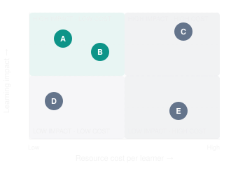
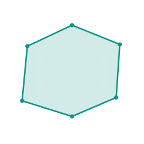

# LEARNING VELOCITY FRAMEWORK — DEFINITION, MEASUREMENT, CONTRIBUTOR REWARDS, MASTERY LEARNING AND CERTIFICATION
(LEARNING VELOCITY THREAD)

## Index

- [[#01 - Defining and Refining Learning Velocity]]
- [[#02 - Measuring Vectors and Rewarding Contributors]]
- [[#03 - Mastery Learning and Conventional Certification]]
- [[#04 - Obsidian Export and Downloadable Components]]

## 01 - Defining and Refining Learning Velocity

> [!NOTE] Prompt
> I want to investigate and develop the concept of “LEARNING VELOCITY “ to define it as a framework for the measurement of speed combined with success of effecting cognitive change (learning) using certain resources, tools, media, services, methods, etc.
>
> It is meant to provide evidence of the effectiveness of the vectors / factors applied to the SOVEREIGN LEARNER in order to provide feedback for improvement of the systems and tools used for transferring knowledge and skill.
>
> Help me describe, refine and augment this concept

# LEARNING VELOCITY

A proposed framework for measuring, understanding, and optimizing the effectiveness of learning within SOVRAEG LABS and the Learning Economy / Education 6.0 ecosystem

## 1. The foundational concept

I believe **LEARNING VELOCITY** can become considerably more valuable than a measurement of how rapidly someone learns.

It can provide the foundation for an entire system of **evidence-based learning effectiveness, continuous pedagogical improvement, intelligent resource orchestration, and learner sovereignty**.

The essential conceptual shift is:

**From measuring how much learning activity occurs to measuring how effectively learning experiences produce lasting, demonstrable changes in knowledge, capability, and independent performance.**

### Proposed formal definition

> **LEARNING VELOCITY (LV)** is the measurable rate at which a learner develops durable, demonstrable, and transferable knowledge or capability, relative to their initial state, through engagement with a defined combination of learning resources, experiences, methods, technologies, and support, accounting for the effort invested and the quality of the resulting evidence.

This definition incorporates five fundamental ideas:

1. **Change:** A meaningful difference between the learner's initial and subsequent capabilities.
2. **Time:** The effort and elapsed time required to produce that change.
3. **Effectiveness:** Whether the desired learning actually occurred.
4. **Durability and transfer:** Whether the capability persists and can be applied independently in appropriate new circumstances.
5. **Attribution:** The extent to which particular learning interventions contributed to the improvement.

The fifth is particularly important.

You are not simply trying to measure how effectively the Sovereign Learner learns. You are also trying to establish **which combinations of learning resources and interventions are effective, for whom, under which conditions, and why**.

That transforms Learning Velocity from a learner-performance metric into a framework for learning-system improvement.

## 2. The key distinction: speed is not velocity

Consider three learners undertaking the same SYNCZINE.

| Learner | Completion time | Outcome |
| --- | --- | --- |
| A | 2 hours | Passes an immediate assessment but cannot reproduce the skill a month later |
| B | 5 hours | Demonstrates mastery, retains it, and applies it independently |
| C | 8 hours | Demonstrates mastery and develops additional insights, creative applications, and the ability to teach others |

If speed alone were the objective, A would appear most successful.

But A may have experienced little durable learning.

B and C have demonstrated different kinds of valuable cognitive and capability change.

This suggests that **Learning Velocity must recognize both the rate and the direction of progress**.

A learner can move rapidly through content without advancing meaningfully toward mastery. Conversely, a learner may progress more slowly while acquiring richer, more transferable capabilities.

This distinction has strong support in learning science. Research on retrieval practice and spaced learning shows why immediate performance and long-term retention should not be treated as interchangeable measures. 

ScienceDirect

+1

### My proposed conceptual principle

# Learning Velocity ≠ Content Consumption Speed

## Learning Velocity = Rate of Evidenced Capability Development

And, more ambitiously:

**The goal is not maximum velocity. It is optimal, sustainable velocity toward capabilities that the learner values and can genuinely exercise.**

This avoids turning the Sovereign Learner into a production unit whose only purpose is to complete more learning activities in less time.

## 3. A multidimensional framework

Learning Velocity should not initially be collapsed into one universal score.

I suggest establishing eight dimensions, with some acting as measured outcomes and others as explanatory or governance variables.

| Dimension | Fundamental question |
| --- | --- |
| **1. Acquisition** | How rapidly does new understanding or skill emerge? |
| **2. Mastery** | How quickly is a defined competency demonstrated to the required standard? |
| **3. Retention** | How much of the capability remains after meaningful delays? |
| **4. Transfer** | Can the learner independently apply the capability in new situations? |
| **5. Efficiency** | What effort, resources, and support were required? |
| **6. Independence** | To what extent can the learner perform without scaffolding or AI assistance? |
| **7. Adaptability** | How effectively does the learner improve, integrate feedback, and adjust strategies? |
| **8. Sovereignty** | Does the process strengthen the learner's agency, control, and self-directed learning capability? |

The first four describe learning outcomes. Efficiency describes resource utilization. Independence and adaptability help characterize the quality of capability development. Sovereignty ensures the optimization respects the purpose of your ecosystem.

Not all eight should have equivalent mathematical weight. Some must serve as **non-negotiable constraints**, rather than quantities that can be traded against speed.

For example, a learning intervention should not receive a higher overall rating merely because it accelerates skill acquisition while undermining the learner's independence or privacy.

## 4. The mathematical model

There are two useful ways to express Learning Velocity.

### A. The practical measurement

For a particular, clearly defined competency:

$$
\boxed{LV_D=\frac{M_D-M_0}{H}}
$$

Where:

- $$
  M_0
  $$
  
   = independently assessed proficiency before learning.
- $$
  M_D
  $$
  
   = independently assessed proficiency at a defined delayed assessment.
- $$
  H
  $$
  
   = total active learning effort in hours.
- $$
  LV_D
  $$
  
   = durable proficiency gain per learning hour.

This is a proposed operational metric, not an established standardized educational measurement.

For example, if proficiency increases from 20 to 80 on a calibrated 100-point scale over eight hours:

$$
LV_D=\frac{80-20}{8}=7.5
$$

The learner gained 7.5 proficiency points per active learning hour, with the gain verified at the specified delay.

This is meaningful only when the assessments measure the same underlying competency on a comparable scale. It must also be interpreted alongside transfer, independent mastery, measurement uncertainty, and the proportion of learners who succeed.

Learning scores are evidence-based estimates of capability, not direct measurements of physical changes in the brain.

### B. The more powerful mathematical interpretation

What if learning is treated as movement through a multidimensional space of competencies rather than progress along a single line?

Let a learner's estimated capability state be represented by:

$$
\mathbf{K}(t)=
\begin{bmatrix}
K_{\text{conceptual}}\\
K_{\text{procedural}}\\
K_{\text{reasoning}}\\
K_{\text{transfer}}\\
K_{\text{metacognitive}}
\end{bmatrix}
$$

We can then define a **Learning Velocity Vector**:

$$
\boxed{\mathbf{LV}(t)=\frac{d\mathbf{K}(t)}{dt}}
$$

Here, the direction describes *what kinds of capabilities are changing*, while magnitude describes the rate of change under appropriately defined measurement scales.

This is a conceptual model. In practice, we would estimate the changes from periodic evidence, not literally observe a continuous cognitive trajectory.

It opens up a much more sophisticated question:

**Does a particular intervention merely improve short-term factual recall, or does it also accelerate reasoning, application, and self-directed learning?**

Two learning methods could exhibit equivalent rates of factual acquisition while producing substantially different rates of procedural mastery and transferable understanding.

That difference is potentially more useful than a single overall score.

## 5. The LEARNING VELOCITY measurement system

I suggest creating a structured family of measurements rather than relying on a single index.

| Metric | What it measures | Application |
| --- | --- | --- |
| Acquisition Velocity (AV) | Immediate proficiency gain per active hour | Assess instructional effectiveness |
| Durable Learning Velocity (DLV) | Delayed proficiency gain per active hour | Primary velocity measure |
| Time to Mastery (TTM) | Time required to reach a predefined mastery threshold | Compare pathways and support |
| Mastery Attainment Rate (MAR) | Proportion of learners achieving independently verified mastery | Measure actual success |
| Retention Ratio (RR) | Proportion of initial gain retained at follow-up | Detect learning decay |
| Transfer Performance (TP) | Demonstrated application in unfamiliar contexts | Evaluate generalization |
| Learning Resource Efficiency (LRE) | Durable gain relative to monetary and resource cost | Evaluate economic efficiency |
| Independence Gap (IG) | Difference between assisted and unassisted performance | Detect reliance on scaffolding |

For retention, one possible metric is:

$$
RR=\frac{M_D-M_0}{M_P-M_0}
$$

where 

$$
M_P
$$

 is immediate post-learning proficiency. This is defined only where immediate gain is positive and must be treated carefully when baseline or post-test differences are very small.

I would retain mastery, transfer, retention, and cost as separately visible measures, even if we eventually develop a composite Learning Velocity Index.

This creates a meaningful distinction between **learning effectiveness** and **learning efficiency**.

### An illustrative comparison

Suppose two versions of a SYNCZINE teach the same competency.

Hypothetical learning outcomes

METHOD A · VIDEO-FIRST

# 5.0

Durable proficiency points per hour

9 learning hours

90 immediate score

65 delayed score

50 transfer score

METHOD B · SPACED + COACHED

# 7.5

Durable proficiency points per hour

8 learning hours

85 immediate score

80 delayed score

75 transfer score

Illustrative scores on comparable 0–100 assessments, with both groups beginning at 20 and delayed assessments at 30 days. These are hypothetical results, not research findings.

Immediate performance versus durable learning

Illustrative proficiency scores on a common assessment scale. Baseline is 20 for both methods.

![[media/chart-01.svg]]

- Baseline: Method A 20, Method B 20
- Immediate: Method A 90, Method B 85
- 30-day delay: Method A 65, Method B 80
- Transfer: Method A 50, Method B 75

A conventional assessment might favor Method A because its immediate score is higher.

Learning Velocity reveals something different: Method B delivers a larger *durable* gain with less learner effort and stronger transfer performance.

In this example, Method B has 50% higher Durable Learning Velocity.

However, we still do not know whether Method B is causally superior unless the comparison controls for prior knowledge, selection effects, assessment conditions, and other confounders.

That leads to perhaps the most important part of your concept.

## 6. From measuring Learning Velocity to measuring the effectiveness of learning vectors

Here, I would make an explicit distinction between two related concepts.

- **Learning Velocity** describes the learner's evidenced progression.
- **Learning Vectors** describe the resources, interventions, experiences, and conditions that may influence that progression.

Think of a Learning Vector as a structured, identifiable influence on learning, rather than a metaphorical force that can automatically be assigned a causal value.

### The seven families of Learning Vectors

01

**Pedagogical vectors**

Retrieval practice, spaced repetition, inquiry, project-based learning, deliberate practice, simulations, scaffolding, reflection

02

**Media and representation vectors**

Text, audio, video, interactive graphics, physical demonstrations, immersive environments, manipulatives

03

**Technological vectors**

AI tutors, adaptive SYNCZ, intelligent feedback, recommendation engines, assistive tools, analytics

04

**Human and social vectors**

Mentors, peers, SOVRAEGES, coaches, guild assessors, collaborative learning communities

05

**Temporal and sequencing vectors**

Pacing, spacing, interleaving, prerequisites, practice frequency, recovery intervals, scheduling

06

**Contextual vectors**

Physical environment, accessibility, available resources, language, learning context, task relevance

07

**Metacognitive and agency vectors**

Goal-setting, self-assessment, reflection, choice, self-regulation, learner-directed adjustments

These classifications would form an initial Learning Vector Taxonomy.

But their real power comes from measuring their interactions.

For example, video combined with mentor feedback could be more effective than either alone. Spaced practice might improve long-term recall while initially slowing task completion. An AI tutor could dramatically improve assisted task performance without equally improving independent mastery.

Such possibilities must be tested rather than assumed.

### The Learning Vector Profile

Every significant learning resource or intervention could have a structured profile containing:

| Attribute | Description |
| --- | --- |
| Vector ID | Persistent identifier and version |
| Intervention type | Pedagogy, medium, technology, support, etc. |
| Intended competency | What the intervention is meant to change |
| Target context | Prerequisites, skill level, language, accessibility |
| Exposure | Duration, frequency, intensity, timing |
| Associated outcomes | Acquisition, retention, mastery, transfer |
| Evidence quality | Reliability and causal confidence |
| Resource cost | Learner effort, mentor time, computation, money |
| Sovereignty conditions | Consent, privacy, agency, portability |

A versioned SYNCZ would have an identifiable Learning Vector Profile. So could a particular mentoring technique, assessment approach, or combination of activities within a SYNCZINE.

I would call a tested combination of such vectors a **Learning Intervention Configuration (LIC)**.

Over time, the system could develop an evidence base of which configurations work best for different competencies and learning circumstances.

## 7. A critical scientific distinction: correlation versus causation

This framework must distinguish between observing that learning occurred and establishing that a particular intervention caused the change.

Consider a SYNCZINE whose learners demonstrate unusually high Learning Velocity.

That result could reflect:

- Excellent instructional design.
- Learners who already had substantial prior knowledge.
- Highly motivated learners self-selecting into the pathway.
- Greater availability of mentors.
- Easier assessments or different measurement conditions.
- An interaction between several factors.

Without evaluating these possibilities, awarding the SYNCZINE a superior effectiveness rating could be misleading.

I suggest three evidence levels.

**Level 1 — Observed effectiveness**

Learning outcomes are measured and associated with particular learning experiences. Useful for diagnostics and generating hypotheses, but not sufficient for causal claims.

**Level 2 — Comparative effectiveness**

Configurations are compared using common assessments and statistical adjustments for relevant differences. More informative, but residual confounding may remain.

**Level 3 — Causally supported effectiveness**

Randomized or appropriately designed quasi-experimental studies establish a credible counterfactual. These can support stronger claims about an intervention's effect.

Difference-in-differences and other quasi-experimental approaches are established ways to evaluate impacts when randomized assignment is impractical, subject to their assumptions. 

UNDP Evaluation

+1

This also suggests a particularly useful concept:

**Learning Velocity Uplift** — the estimated improvement in durable learning outcomes attributable to an intervention, compared with an appropriate alternative.

It should be reported at a specified effort level or over a fixed evaluation period, not inferred automatically from a difference between two raw velocity ratios.

A SYNCZINE could have a high observed Learning Velocity but weak causal evidence. Another might have a smaller measured improvement supported by a rigorous study. That distinction should remain visible to SOVRAEGES, learners, and other stakeholders.

## 8. Integrating Learning Velocity throughout the SOVRAEG ecosystem

This is where the concept becomes strategically important for SOVRAEG LABS.

Learning Velocity could provide a common evidence framework connecting the design, delivery, assessment, improvement, and governance of your learning ecosystem.

**SOVEREIGN LEARNER**

Goals · Initial capability · Context · Agency

SYNCZ / SRLO

Learning activities and interventions

SYNCZINE

Path orchestration and sequencing

SOVRAEGIX

Human and AI learning support

SYNCTESS

Evidence of demonstrated capability

**LEARNING VELOCITY EVIDENCE ENGINE**

Measure · Compare · Attribute · Recommend · Validate

SYNCFORGE

Improve learning components and pathways

SOVRAEGES

Optimize coaching and support

SYNTHCREDS

Verify and attest achieved mastery

SOVRAEGENCIES

Evaluate outcomes and stewardship

SOVRAEGIS governs evidence standards, privacy, interoperability, quality, and the improvement cycle.

### SYNCZ / SRLO — Measurement at the learning-object level

Each SYNCZ could declare its intended competency outcomes, prerequisites, instructional methods, assessment opportunities, and evidence requirements.

Learning events can reveal how learners interact with different components, but interactions alone do not establish learning.

The key is relating what happened *within* a SYNCZ to independently demonstrated changes in capability.

### SYNCZINE — Measurement at the learning-path level

A SYNCZINE could evaluate not only whether individual components work, but whether their **sequence, timing, dependencies, and combinations** improve learning.

Two SYNCZINES may use identical SYNCZ components but produce different outcomes because of their orchestration.

This could eventually enable evidence-informed path optimization.

### SYNCTESS — The evidence layer

SYNCTESS, grounded in CODE+V, is particularly well suited to supporting Learning Velocity because it captures richer evidence than ordinary completion records.

For example:

- **Curate:** Evidence of evaluating and selecting relevant knowledge sources.
- **Organize:** Evidence of structuring understanding and planning learning.
- **Distill:** Evidence of synthesis, conceptual understanding, and reflection.
- **Express:** Demonstrated application or production of knowledge and skill.
- **Verify:** Feedback, critique, corroboration, and assessment interactions.
- **Validate:** Evidence that the required competency standard has been satisfied.

These artifacts can support assessments of cognitive and skill development across time.

An important refinement: the quantity of SYNCTESS artifacts must never be mistaken for the amount of learning. Their quality, relevance, and evidentiary strength matter.

### SYNTHCRED — Verified achievement, not speed

SYNTHCREDS would attest achieved mastery against defined requirements.

Learning Velocity can help explain how mastery was developed and which learning experiences supported it, but **velocity itself should not become a credential requirement**.

A learner who achieves mastery slowly should receive the same competency recognition as one who achieves it quickly, assuming both meet the same standards.

### SOVRAEGIX and SOVRAEGES — Guided improvement

The platform could provide actionable evidence to mentors:

A learner is progressing rapidly in factual acquisition but struggling to transfer skills into practical tasks.

That is more useful than simply reporting that the learner is behind schedule.

SOVRAEGES could then select alternative interventions, while subsequent evidence establishes whether those interventions helped.

### SOVRAEGENCIES — Outcome-oriented stewardship

At the enterprise level, a SOVRAEGENCY could be evaluated on such outcomes as sustained mastery attainment, accessibility, learner independence, resource efficiency, and educational reach.

This gives you a basis for the dual financial and stewardship metrics you've been developing.

However, compensation should not reward high raw velocity or easy credential attainment. Such incentives could encourage organizations to select easier learners, reduce assessment difficulty, or neglect people requiring additional support.

Use independently assessed outcomes, inclusion measures, evidence quality, and long-term stewardship.

## 9. The LEARNING VELOCITY OBSERVATORY

I would propose a dedicated capability called the **Learning Velocity Observatory (LVO)** within SOVRAEGIS.

Its function would be to transform learning evidence into actionable intelligence across the ecosystem.

It would support three distinct perspectives.

**Sovereign Learner Observatory**

Helps the individual understand progress toward mastery, retained capabilities, potential knowledge gaps, and available alternative learning routes.

The learner should be able to challenge interpretations and make meaningful choices about recommendations.

**Learning Design Observatory**

Helps SYNCFORGE authors, educators, and mentors identify which activities, media, instructional configurations, and assessment designs warrant improvement or further testing.

**Ecosystem Effectiveness Observatory**

Provides aggregated, appropriately privacy-protected evidence for SOVRAEGENCIES, GUILDS, and the platform's governance functions.

It would emphasize verified outcomes, reliability, accessibility, cost-effectiveness, and comparative intervention evidence.

The observatory should distinguish diagnostic signals from verified conclusions and display uncertainty, sample size, assessment quality, and evidence level.

### Technical and standards alignment

You already have a promising foundation in the architecture of SYNCZ and SYNCZINES.

The current ISO/IEC/IEEE 39274-1-1:2025 standard provides an internationally standardized xAPI mechanism for exchanging learning experience records with Learning Record Stores. 

ISO

That provides a basis for recording intervention exposure and learner activity, but xAPI statements do not, by themselves, establish mastery or causation.

SYNCTESS could supply richer performance evidence, and SYNTHCREDS could use W3C Verifiable Credentials to communicate validated outcomes. The W3C Verifiable Credentials Data Model v2.0 became a Recommendation in May 2025. 

W3C

I would separate this architecture into four layers:

1. **Experience telemetry:** What learning activities occurred?
2. **Competency evidence:** What can the learner actually demonstrate?
3. **Learning effectiveness analysis:** What changed, with what confidence, and what might explain it?
4. **Verified attainment:** What knowledge or skill has been independently validated?

This separation is essential for both scientific credibility and learner sovereignty.

## 10. Five further concepts worth developing

The velocity framework also suggests several powerful subsidiary constructs. These would be proposed SOVRAEG-specific analytical concepts requiring operational definitions and validation.

| Concept | Meaning | Strategic value |
| --- | --- | --- |
| **Learning Acceleration** | Change in Learning Velocity across successive learning periods | Detects increasing proficiency or stagnation |
| **Learning Friction** | Obstacles, unnecessary effort, confusion, and resource overhead slowing progress | Identifies improvements to SYNCZ and SYNCZINES |
| **Learning Resilience** | Ability to retain, reconstruct, or rapidly reacquire capability after interruption | Measures robustness rather than short-term success |
| **Learning Vector Synergy** | Additional effectiveness arising from combinations of interventions | Supports intelligent learning orchestration |
| **Learning Autonomy Growth** | Development of the capacity to plan, regulate, evaluate, and redirect one's own learning | Directly supports the Sovereign Learner ethos |

Of these, Learning Vector Synergy and Learning Autonomy Growth may be particularly valuable differentiators.

Consider an AI tutor, a SYNCZ simulation, and a human mentor. Each may independently offer a learning benefit, but it is possible that the right combination and timing yields a substantially better outcome than their individual contributions.

The Observatory could progressively build evidence about those interactions.

Similarly, an intervention that teaches learners to identify their own misunderstandings may initially consume more time but improve Learning Velocity across many future competencies.

That creates a potential **compounding effect**, where the value of learning extends beyond a single SYNCZINE.

## 11. Learning sovereignty must be designed into the measurement system

This is an area where SOVRAEG LABS could establish a genuinely distinctive position.

Many conventional learning analytics systems are oriented toward institutional observation and prediction. Your framework should instead prioritize the learner's understanding, agency, and control.

Research on student-facing learning analytics has also emphasized the importance of pedagogical design and involving learners in the development of the analytics themselves. 

Journal of Learning Analytics

I would establish these governance principles:

- **Learner control:** Individuals can inspect their data and understand how conclusions were reached.
- **Purpose limitation:** Evidence gathered to improve learning is not automatically available for commercial profiling, ranking, or other secondary uses.
- **Data minimization:** Store derived indicators where possible instead of retaining unnecessary detailed histories.
- **Assistance transparency:** Distinguish performance with AI or other tools from independent demonstrated capability, where the distinction is relevant to the competency.
- **Fair comparisons:** Account for baseline capability, accessibility, available support, and learner context before comparing interventions.
- **Right to contest:** Allow evidence, mastery estimates, and recommendations to be challenged and corrected.
- **Independent participation:** Learners should not have to surrender extensive personal telemetry merely to demonstrate competency and obtain a credential.

DIDs, verifiable credentials, local-first storage, and selective disclosure may help implement this architecture, but the governance rules remain essential. Cryptography alone does not make analytics fair or privacy-preserving.

## 12. A practical pilot: validating Learning Velocity

I would not begin by building a complex intelligence engine.

I would begin with one well-defined competency, one SYNCZINE, and two alternative Learning Intervention Configurations.

Your earlier example of a martial-arts kata would actually be a particularly useful starting point because it requires demonstrable physical mastery, sequencing, recall, precision, and independent performance.

### Example: Heian Shodan Kata


The intended competency could be the learner's ability to perform the kata correctly, consistently, and independently, according to a clearly documented assessment rubric.

## Learning Velocity Pilot Protocol

1. **Establish baseline capability**
  
  Assess relevant techniques, sequencing knowledge, and current kata performance using a defined rubric.
2. **Compare two learning configurations**
  
  Configuration A: video demonstrations and individual practice.
  
  Configuration B: interactive SYNCZ components, spaced practice, and structured mentor feedback.
  
  Randomly assign learners where practical, or use an appropriately designed alternative that accounts for baseline differences.
3. **Record intervention exposure**
  
  Measure active practice time, resources consulted, feedback received, and support utilized.
4. **Assess independently demonstrated performance**
  
  Use consistent rubrics and, where possible, blinded assessments of recorded performances.
5. **Evaluate durability**
  
  Repeat the assessment after a predefined delay, such as 30 days, documenting additional practice or coaching during the interval.
6. **Evaluate transfer and independence**
  
  Test individual techniques in unfamiliar combinations or contexts appropriate to the intended skill, and assess performance without live instructional prompts.
7. **Compare learning effectiveness**
  
  Examine durable gain, time to mastery, the proportion achieving mastery, transfer performance, and total resource costs. Record uncertainty rather than declaring winners from small differences.

A small pilot would establish whether the assessments, instrumentation, and workflow are feasible. A sufficiently powered comparative study would then be needed to support reliable intervention-effect claims.

The pilot could generate not only a SYNTHCRED for qualifying learners, but also evidence for improving both SYNCZINE configurations.

And the CODE+V SYNCTESS could preserve authentic demonstrations and reflective evidence independently of the analytics engine.

## 13. A proposed initial SOVRAEG specification

I would formalize the concept as a new capability under SOVRAEGIS.

PROPOSED FRAMEWORK

## SOVRAEG LEARNING VELOCITY FRAMEWORK — SLVF v0.1

**Purpose:** Establish interoperable, ethical, evidence-based methods for evaluating durable learning progression and the effectiveness of learning interventions.

**Primary measurement:** Durable Learning Velocity.

**Primary outcome:** Independently demonstrated, sustained mastery of predefined competencies.

**Supporting outcomes:** Time to mastery, mastery attainment, retention, transfer, independence, and resource efficiency.

**Analytical capability:** Learning Vector profiling, comparative analysis, and causal impact evaluation.

**Evidence infrastructure:** SYNCZ telemetry, SYNCTESS artifacts, assessment rubrics, longitudinal evaluations, and verified SYNTHCREDS.

**Intelligence infrastructure:** Learning Velocity Observatory.

**Governance:** Learner sovereignty, transparent evidence standards, fairness, data minimization, and scientific validity.

### Recommended development sequence

| Stage | Deliverable |
| --- | --- |
| **1. Define** | Formal ontology and glossary of Learning Velocity, Vectors, and outcomes |
| **2. Instrument** | Assessment rubrics, intervention profiles, events, and evidence schemas |
| **3. Pilot** | Initial SYNCZINE comparison with immediate and delayed assessments |
| **4. Validate** | Assessment reliability, measurement comparability, retention, transfer, and causal methods |
| **5. Operationalize** | Observatory dashboards, feedback workflows, and authoring integrations |
| **6. Scale** | Evidence-based recommendations, vector synergy analysis, and ecosystem governance |

The central scientific challenge will not be telemetry collection. It will be constructing trustworthy measurements of change in competencies and establishing what interventions genuinely contributed to those changes.

That should be the research and engineering priority.

## 14. The greater strategic opportunity for SOVRAEG LABS

There is another implication that I consider especially important.

In an AI-saturated Learning Economy, the generation of learning content may become increasingly inexpensive.

But four things remain difficult:

1. Knowing whether a learner actually acquired a capability.
2. Knowing whether that capability is durable and transferable.
3. Knowing which interventions genuinely improved the outcome.
4. Knowing how to apply that evidence to improve future learning without compromising the learner's sovereignty.

This creates an opportunity to move SOVRAEG LABS beyond content production, learning-path authoring, and credential issuance.

**SOVRAEG LABS could become an evidence infrastructure provider for the Learning Economy.**

The competitive value would not reside merely in owning learning content or activity logs. It would come from a trusted combination of validated competency models, interoperable evidence protocols, rigorous intervention evaluation, and effective improvement workflows.

Such capabilities could support creators, learners, mentors, GUILDS, and independent SOVRAEGENCIES without requiring the platform to own everyone's underlying personal data.

There is also a possible longer-term market for independently verified **Learning Effectiveness Profiles** of educational resources, methods, and services.

For example, an educational tool could make a qualified claim such as:

> In a specified learner population and competency domain, this intervention improved independently assessed durable mastery relative to a defined comparison, with documented evaluation methods and uncertainty.

That is substantially more meaningful than claiming that thousands of learners completed a course or that a particular technology increased engagement.

It could eventually support a marketplace in which learning products compete on transparent, context-specific evidence rather than marketing claims.

## 15. The principle I would establish at the center

Learning Velocity should ultimately answer two intertwined questions.

**For the Sovereign Learner:**

> How effectively am I developing the knowledge, skills, understanding, and independence necessary to pursue my chosen goals?

**For the Learning Economy:**

> Which learning experiences, resources, methods, and support systems demonstrably improve that development, for which learners, under which conditions, and at what cost?

The resulting framework would measure more than instructional speed.

It would establish a continuous relationship between **LEARNING → EVIDENCE → UNDERSTANDING → IMPROVEMENT → GREATER LEARNING CAPABILITY**.

And perhaps the most consequential addition is this:

**The highest expression of Learning Velocity is not merely enabling the learner to learn a particular skill faster. It is helping the Sovereign Learner become increasingly capable of directing, evaluating, and improving their own learning throughout life.**

That makes Learning Velocity not only a metric for the SOVRAEG ecosystem, but a candidate foundational principle for its approach to Education 6.0.

## 02 - Measuring Vectors and Rewarding Contributors

> [!NOTE] Prompt
> Within the LEARNING VELOCITY concept (is it a PROTOCOL, FRAMEWORK, MODEL, SYSTEM, METHODOLOGY?? what can we call it?) how can we generate ways/standards to measure the effectiveness of each of the contributing vectors to the LEARNING VELOCITY formula ? We want ways to graph this data visually so we can observe it more readily , we want ways to reward human contributors (activity and learning path / SYNCZ/SYNCTESS/SYNCZINE designers and SOVRAEGES (teachers, coaches, mentors) and even SOVRAEGENTS (Agentic AI support)

# LEARNING VELOCITY

## Designing the measurement, visualization, attribution, and reward architecture for SOVRAEGIS

I recommend developing **LEARNING VELOCITY as a comprehensive framework**, supported by a measurement model, interoperability standards, evaluation methodologies, and an operational intelligence system.

The most important innovation would be extending Learning Velocity beyond measuring the Sovereign Learner's progress to determining the **measurable contribution of each learning vector** — including the SYNCZ, SYNCZINES, SYNCTESS designers, SOVRAEGES, and SOVRAEGENTS responsible for creating and supporting the learning experience.

That could become the basis for a transparent, evidence-driven contributor economy.

## 1. What should we call it?

The terms *framework, model, protocol, methodology,* and *system* are not mutually exclusive. They describe different architectural layers.

| Term | Role within Learning Velocity |
| --- | --- |
| **Framework** | The overarching conceptual architecture, principles, and governance |
| Model | Mathematical representation of learning and intervention effects |
| Methodology | How evidence is collected, evaluated, and interpreted |
| Standard | Agreed definitions, metrics, units, schemas, and quality requirements |
| Protocol | How systems exchange observations, evidence, and results |
| System | The operational software implementing the framework |
| Index | A standardized composite score for a specific purpose |
| Observatory | The dashboards, analytics, and interpretation environment |

### Proposed naming architecture

## SLVF

**SOVRAEG Learning Velocity Framework**

The overarching scientific, pedagogical, and governance framework

SLVM

Measurement Model

Quantifies durable learning progression

SLVS

Measurement Standards

Defines comparable metrics and evidence rules

SLVP

Evidence Protocol

Exchanges intervention, assessment, and attribution records

SLVE

Evaluation Methodology

Tests effectiveness and causal contribution

SLVO

Learning Velocity Observatory

Visualizes insights and effectiveness

SLVR

Reward and Recognition Model

Allocates value to qualifying contributors

These would initially be **proposed SOVRAEG specifications**, not existing accredited international standards.

I would use SLVF as the umbrella term and **Learning Vector Effectiveness (LVE)** as the core analytical construct for measuring how much each factor contributes.

This gives you two separate, complementary measurements:

- **Learning Velocity (LV):** How effectively and rapidly does capability develop?
- **Learning Vector Effectiveness (LVE):** How much does a particular intervention contribute to that development?

A learner could experience strong LV through a combination of SYNCZ activities, human coaching, AI tutoring, and independent practice. LVE seeks to identify the contribution of those components rather than assuming they were equally influential.

## 2. A mathematical model for vector effectiveness

I suggest distinguishing three classes of measurement.

### Layer A — Observed Learning Velocity

At a particular competency and delayed assessment interval:

$$
LV_D=\frac{M_D-M_0}{H}
$$

Where 

$$
M_D
$$

 is delayed demonstrated proficiency, 

$$
M_0
$$

 is baseline proficiency, and 

$$
H
$$

 is active learning time.

This is a measure of observed learner progress, not evidence of which factor caused it.

### Layer B — Causal Learning Vector Effectiveness

For vector 

$$
i
$$

, define:

$$
\boxed{LVE_i=\frac{\mathbb{E}[G\mid do(V_i=1)]-\mathbb{E}[G\mid do(V_i=0)]}{H^*}}
$$

Here:

- $$
  G
  $$
  
   is durable proficiency gain at a specified assessment delay.
- $$
  V_i
  $$
  
   means that the vector is provided, rather than replaced by an appropriate comparison condition.
- $$
  do(\cdot)
  $$
  
   represents a conceptual causal intervention, not merely observing whether a learner happened to use the vector.
- $$
  H^*
  $$
  
   is a common reference effort budget, if the outcome is evaluated at fixed effort.

This estimates the vector's contribution to durable gain per reference learning hour, in a defined learner population and context.

For studies comparing ordinary learning programs with different actual durations, it may be preferable to report causal effects on durable gain, mastery probability, and total time separately. Ratios alone can obscure important differences.

**Importantly, the effect of a vector is not a universal property of that vector.** A mentor, video, or AI agent could be extremely effective for one competency or learner population and relatively ineffective for another.

### Layer C — Vector interactions and synergy

Suppose a learner receives an interactive SYNCZ and human coaching.

The combined benefit might differ from the sum of their individual benefits.

For two vectors, A and B, define the interaction:

$$
S_{AB}=G_{AB}-G_A-G_B+G_0
$$

All four terms are comparable expected outcomes under the four intervention configurations.

- Positive 
  
  $$
  S_{AB}
  $$
  
  : Synergistic effect.
- Zero 
  
  $$
  S_{AB}
  $$
  
  : Additive effect.
- Negative 
  
  $$
  S_{AB}
  $$
  
  : Diminishing or antagonistic interaction.

This is especially relevant for your ecosystem because SYNCZINES are orchestrated combinations of learning objects, human interventions, and agentic support.

The value often lies not in the individual component but in **how its interaction with other components improves learning**.

## 3. Establish a Learning Vector Effectiveness Standard

I propose a standardized **Learning Vector Effectiveness Profile (LVEP)** for each component or contributor role.

Every vector should declare a common core of information, while supporting role-specific measures.

| Measurement | Definition | Unit or representation |
| --- | --- | --- |
| Exposure | How much of the vector was delivered or used | Minutes, sessions, attempts |
| Fidelity | Whether it was delivered as designed | Rubric-based percentage |
| Acquisition effect | Change in immediate proficiency attributable to the intervention | Proficiency points |
| Durable effect | Change in delayed proficiency attributable to the intervention | Points at a defined interval |
| Mastery effect | Change in probability of achieving required mastery | Percentage points |
| Transfer effect | Change in ability to apply learning independently | Assessment score difference |
| Time effect | Change in time needed to achieve mastery | Hours, days |
| Resource effect | Human, computational, or financial requirements | Hours, CPU/GPU usage, money |
| Evidence confidence | Strength and uncertainty of the result | Confidence interval, evidence tier |
| Context | Conditions in which the result applies | Structured metadata |

The profile would also contain version identifiers, assessment definitions, comparison conditions, contributor identifiers, permissions, and provenance.

### A major standards requirement

**Never compare two LVE scores without establishing that their outcomes, contexts, and measurement scales are sufficiently comparable.**

A video about algebra and a martial-arts coaching session should not compete on a universal proficiency-points-per-hour leaderboard.

Rather, effectiveness should be evaluated against a meaningful reference:

- Similar competency.
- Similar initial proficiency.
- Similar opportunity to learn.
- Similar assessment standards.
- Similar learner support and accessibility conditions.
- Comparable evaluation timing.

This suggests creating **Learning Effectiveness Reference Classes**: well-defined groups of competencies and contexts within which meaningful comparisons can occur.

## 4. Different vectors require different evidence of effectiveness

Not every contributor creates value in the same way. The framework should distinguish the *type of contribution* before calculating its effect.

| Vector / contributor | Primary contribution | Key effectiveness evidence |
| --- | --- | --- |
| SYNCZ designer | Designs individual learning interventions | Durable gain attributable to component versions |
| SYNCZINE designer | Composes and sequences learning experiences | Improvement in pathway-level mastery and efficiency |
| SYNCTESS designer | Creates evidence and assessment structures | Assessment reliability, validity, feedback usefulness |
| SOVRAEGE educator | Provides instruction and explanation | Learning gains from instructional intervention |
| SOVRAEGE coach | Facilitates practice and performance improvement | Skill improvement and transfer |
| SOVRAEGE mentor | Supports strategy, direction, and learner agency | Autonomy growth, retention, long-term progression |
| SOVRAEGENT | Delivers agentic AI guidance, practice, or feedback | Incremental benefit over comparable alternatives |
| Peer contributor | Provides feedback, explanation, or collaboration | Verified peer-learning contribution |

One especially important distinction is that SYNCTESS assessment designers may improve the **quality of the measurement** without directly increasing a learner's capability.

That is valuable but different from accelerating learning.

Similarly, a mentor may prevent dropout, improve independence, or restore learner motivation without producing the greatest immediate score gains.

Therefore, I would develop three related contributor-value classes:

**Learning Impact:** Measured improvement in durable, transferable capability.

**Evidence Impact:** Improvement in the reliability, integrity, accessibility, or usefulness of learning evidence.

**Stewardship Impact:** Improvement in learner autonomy, inclusion, continuity, well-being, and long-term opportunity.

Each is valuable. None should be disguised as the others.

## 5. Visualizing Learning Velocity and vector contributions

The Observatory should be designed around questions people need to answer rather than simply displaying large collections of metrics.

Here are five proposed visualizations, using entirely hypothetical data.

### Visualization A — The Learning Velocity trajectory

A learning trajectory visualizes how demonstrated proficiency evolves over time.

Learning trajectory by intervention configuration

Illustrative proficiency scores, measured on common 0–100 competency scales. The later observations include delayed assessments.

![[media/chart-02.svg]]

- Day 0: Conventional pathway 20, Optimized SYNCZINE 20
- Day 3: Conventional pathway 39, Optimized SYNCZINE 44
- Day 7: Conventional pathway 65, Optimized SYNCZINE 72
- Day 14: Conventional pathway 83, Optimized SYNCZINE 87
- Day 30: Conventional pathway 68, Optimized SYNCZINE 85
- Day 60: Conventional pathway 59, Optimized SYNCZINE 80

The important patterns are not just which line rises faster, but which learning configuration produces the most durable capability.

The Observatory could display assessment confidence intervals, learning effort, intervention changes, and the timing of mentor or AI support.

### Visualization B — Comparative Learning Vector Effectiveness

Illustrative incremental effects of learning interventions

Hypothetical causal estimates of 30-day durable proficiency gain compared with a defined alternative. Common scale and reference learner population.

![[media/chart-03.svg]]

- Human feedback: Incremental proficiency points 14
- Adaptive practice: Incremental proficiency points 11
- Spaced retrieval: Incremental proficiency points 9
- AI tutoring: Incremental proficiency points 7
- Interactive video: Incremental proficiency points 4
- Static reference: Incremental proficiency points 2

This provides an easily understood ranking of interventions within a specific study.

A production version should include uncertainty intervals, sample sizes, evaluation designs, and comparison conditions. A bar chart showing a small estimated difference should not imply that one vector is reliably better.

### Visualization C — The effectiveness–cost portfolio

This is valuable for deciding where to direct SYNCFORGE development and SOVRAEGENCY resources.

Illustrative intervention effectiveness versus cost



A · Spaced retrieval

B · Adaptive practice

C · Human coaching

D · Static video

E · Immersive simulation

Conceptual positions only; not empirical estimates. Actual costs must include development, delivery, maintenance, human time, and infrastructure.

This visualization should not automatically prioritize the cheapest intervention. Human coaching may be essential for learners or competencies where an inexpensive automated alternative does not achieve an acceptable standard.

### Visualization D — The individual contributor effectiveness profile

Different contributors can be evaluated across a consistent set of dimensions while preserving their differing responsibilities.

**Illustrative contributor profile**

SOVRAEGE mentor



Durable impact

78

Mastery support

92

Transfer

85

Efficiency

74

Autonomy

96

Evidence quality

86

Interactive prototype using hypothetical scores. In production, normalize indicators only within suitable reference groups and display evidence confidence and cohort coverage.

A radar profile is useful for understanding strengths and development opportunities. It should not become a global leaderboard of teachers, designers, and AI agents.

### Visualization E — Learning Vector Synergy Matrix

This answers a different question: which combinations of interventions work especially well together?

Hypothetical interaction effects

SYNCZ

Mentor

AI

Spacing

SYNCZ

—

+5

+2

+4

Mentor

+5

—

+3

+1

AI

+2

+3

—

-1

Spacing

+4

+1

-1

—

Stronger positive synergy

Negative interaction

Values represent hypothetical interaction effects in proficiency points, not proven findings. Pairwise interactions should be estimated from suitable comparative designs; the matrix does not capture higher-order combinations.

This could be particularly important for SYNCFORGE: designers could inspect whether adding a particular activity to a SYNCZINE improves outcomes beyond what the individual activities achieve independently.

## 6. The critical problem: how do we fairly attribute learning value?

This is the central challenge if Learning Velocity is to drive financial rewards.

Imagine a learner achieves a SYNTHCRED after working with:

- Four SYNCZ components designed by different authors.
- A SYNCZINE architect who assembled the learning path.
- A SYNCTESS designer who developed the assessment.
- Two SOVRAEGES who coached the learner.
- One SOVRAEGENT that provided personalized practice.

Every one of these contributors may have created value.

But who deserves credit, and how much?

**We must distinguish participation, association, and causal contribution.**

### Three tiers of contribution attribution

**Tier 1 — Verified participation**

We can establish that the contributor produced a resource, delivered support, or performed a service.

Appropriate for contractual fees and basic participation rewards, not claims that they caused mastery.

**Tier 2 — Evidence-associated contribution**

We observe that a contributor's intervention was associated with beneficial outcomes, adjusted for known differences.

Appropriate for provisional performance recognition, with uncertainty and safeguards.

**Tier 3 — Causally supported contribution**

A robust comparative evaluation supports the conclusion that the intervention increased learning effectiveness.

Appropriate for validated effectiveness premiums and evidence-based resource recommendations.

### Should we use Shapley Values?

Shapley Values, originally developed in cooperative game theory, are an interesting candidate for distributing value across contributors whose combined work produced an outcome.

They allocate a defined total value using each participant's average marginal contribution across hypothetical coalitions.

But there are limitations.

A Shapley allocation is only as meaningful as the value function used to calculate it. If the underlying model is correlational, a Shapley decomposition does not magically produce causal evidence.

There can also be substantial difficulty defining the value of every possible contributor combination.

I would therefore use **Shapley-style allocation as an optional reward-accounting mechanism**, informed by valid contribution evidence, rather than as the primary method of establishing causal learning effectiveness.

For practical implementation, I recommend a hybrid compensation system.

## 7. The SOVRAEG Learning Contribution and Rewards Model

Proposed name: SLCR — SOVRAEG Learning Contribution & Rewards

I suggest separating four reward mechanisms.

### A. Creation royalties

Compensate contributors for the use of their intellectual, creative, and design contributions.

Examples include SYNCZ components, SYNCZINES, original assessments, simulations, and reusable pedagogical designs.

Payment can depend on licensing terms, authorized usage, and contractual revenue shares.

This ensures contributors have an opportunity to earn from their work before large-scale effectiveness studies become available.

### B. Service compensation

Reward SOVRAEGES for teaching, coaching, mentoring, assessing, and other authorized services.

A mentor who works with a learner requiring extensive support should be compensated for that professional work, whether or not the learner achieves rapid mastery.

### C. Validated impact rewards

Allocate a separate incentive pool according to evidence of incremental durable learning benefit.

This pool can recognize high-performing interventions and the people responsible for creating or delivering them.

It must account for evidence strength, uncertainty, attribution, accessibility, and learner context.

### D. Stewardship rewards

Reward actions that sustain and improve the commons, such as accessible content creation, peer review, assessment calibration, maintenance, localization, interoperability, and support for underserved learners.

These should not depend solely on short-term proficiency gains.

### A proposed compensation equation

$$
\boxed{R_i=B_i+S_i+I_i+W_i}
$$

Where:

- $$
  B_i
  $$
  
  : Base creation or licensing compensation.
- $$
  S_i
  $$
  
  : Authorized service payments.
- $$
  I_i
  $$
  
  : Evidence-supported impact incentives.
- $$
  W_i
  $$
  
  : Stewardship and commons contributions.

For the impact incentive:

$$
I_i=P_{\text{impact}}\times
\frac{a_iq_i}{\sum_j a_jq_j}
$$

Where:

- $$
  P_{\text{impact}}
  $$
  
   is the predetermined eligible impact pool.
- $$
  a_i
  $$
  
   is the contributor's nonnegative, governance-approved attribution weight.
- $$
  q_i
  $$
  
   is an evidence-quality or confidence adjustment between 0 and 1.

This is an **allocation rule**, not a scientific formula for proving learning impact.

If the evidence is insufficient, the relevant pool should be withheld, redirected to validation work, or distributed through an explicitly non-performance-based policy. The formula should never force a weak or harmful intervention to earn a positive impact premium merely because other contributors received lower scores.

Additional guardrails are necessary: independent assessment, attribution audits, anti-gaming checks, appeal rights, accessibility adjustments, and transparent contracts.

### Illustrative reward distribution

Suppose a SYNCZINE generates a $10,000 eligible contributor pool after applicable costs and contractual deductions.

Hypothetical contributor reward allocation

Hypothetical contributor reward allocation

An illustrative allocation across four reward pools, not an automatically prescribed split.

![[media/chart-04.svg]]

- Creation royalties: $3K
- Service payments: $3.5K
- Impact incentives: $2.5K
- Stewardship: $1K

| Creation royalties | $3,000 |
| --- | --- |
| Service compensation | $3,500 |
| Validated impact | $2,500 |
| Stewardship | $1,000 |
| **Total** | **$10,000** |

Example amounts only. Actual pool sizes would depend on the SOVRAEGENCY's economic arrangements and governance decisions.

### Interactive contributor impact allocation

Here is a simple way to experiment with how effectiveness evidence could influence a reward pool.

Impact allocation simulator

Illustrative, governance-approved weights

Available pool

# $2,000

SYNCZ designer

$694

85

SYNCZINE architect

$531

65

SOVRAEGE mentor

$449

55

SOVRAEGENT operator

$327

40

The entire pool is allocated according to the selected weights.

Reset

These weights are not measured causal effects. In production they would be supplied through the SLCR's approved attribution methodology and evidence requirements.

Notice that this arrangement avoids forcing a choice between rewarding the people who create learning resources and those who deliver essential human support.

It also creates a mechanism for allocating economic value to effective, reusable open learning infrastructure.

## 8. How should we reward SOVRAEGENTS?

Agentic AI introduces a different economic and governance problem.

A SOVRAEGENT can perform tutoring, give feedback, create practice activities, adapt learning paths, and assist with assessment.

But the AI agent itself does not necessarily have the same standing as a human contributor who holds contractual rights, bears professional responsibility, or receives economic compensation.

I recommend distinguishing:

- **SOVRAEGENT effectiveness:** The measured contribution of the AI service to learner outcomes.
- **SOVRAEGENT operating value:** The cost-efficiency and reliability of providing that service.
- **SOVRAEGENT beneficiary:** The person, organization, collective, or commons fund contractually entitled to compensation.

The reward beneficiary might be the agent developer, an independent SOVRAEGENCY operating the agent, an infrastructure provider, or a community treasury.

### Proposed SOVRAEGENT effectiveness scorecard

| Metric | Meaning |
| --- | --- |
| Durable Learning Uplift | Incremental retained capability attributable to agent support |
| Learning Independence | Whether learners can perform without the agent afterward |
| Intervention Precision | Whether the agent provides appropriate support when needed |
| Feedback Quality | Accuracy and pedagogical usefulness of feedback |
| Operational Efficiency | Benefit relative to inference costs and infrastructure |
| Safety and Governance | Compliance with learner permissions, privacy, and required safeguards |

I would strongly discourage compensating agents according to the number of messages generated, total engagement time, or number of tasks performed.

Those incentives could favor unnecessary interventions and learner dependence.

**The ideal SOVRAEGENT helps learners become more capable and, where appropriate, less reliant on the agent itself.**

That is a powerful expression of learner sovereignty.

## 9. Learning Vector Contribution Records

To operate SLVF across SOVRAEGIS, I recommend introducing another data object:

**LVCR — Learning Vector Contribution Record**

An LVCR would document a particular contribution and connect it to observed learning evidence.

It could include the following information:

| Field | Example |
| --- | --- |
| Contribution ID | Unique, immutable record ID |
| Contributor | DID, organization ID, or authorized pseudonym |
| Contributor role | SYNCZ designer, SOVRAEGE, agent operator |
| Resource ID | Specific SYNCZ / SYNCTESS / SYNCZINE version |
| Contribution type | Design, instruction, mentoring, evaluation |
| Competency reference | Targeted learning outcome |
| Learning context | Defined comparison or reference class |
| Evidence references | Permissioned SYNCTESS and assessment references |
| Observed outcome | Durable proficiency and mastery measurements |
| Estimated attribution | Effect estimate with uncertainty |
| Evidence classification | Observational, comparative, causal |
| Reward entitlement | Contract or governance policy reference |
| Validation | Issuer, attestation, timestamp, provenance |

This creates an auditable separation between recording contribution, measuring effects, and calculating compensation.

It also allows contribution evidence to be independently verified without exposing all of a learner's underlying activity history.

## 10. Standards and interoperability

Rather than inventing every part of the infrastructure, SOVRAEG LABS should build upon existing educational interoperability standards.

Two particularly relevant foundations are:

**

[1EdTech Caliper Analytics](https://www.1edtech.org/standards/caliper?utm_source=chatgpt.com)

:** Defines common learning activity and interaction profiles across educational applications. Its existing profiles include assessment, feedback, media, and tool use. 

1EdTech

**

[W3C Verifiable Credentials Data Model v2.0](https://www.w3.org/TR/vc-data-model-2.0/?utm_source=chatgpt.com)

:** Provides an interoperable model for cryptographically verifiable claims, suitable for attestations of contribution, assessment, and qualifying achievements. 

W3C

I recommend designing SLVP as an extension and orchestration of existing event, evidence, identity, and credential standards rather than another isolated telemetry format.

The novel part is the standardized connection between:

**LEARNING INTERVENTION**

Who or what contributed, and how?

**EVIDENCE OF CAPABILITY CHANGE**

What demonstrable learning occurred?

**EFFECTIVENESS EVALUATION**

What incremental impact can be supported?

**CONTRIBUTOR RECOGNITION**

What value or reward is justified?

Privacy-preserving aggregation and separation of personal learning records from financial attribution records should be architectural requirements from the outset.

## 11. The initial Learning Velocity Observatory dashboard

I would organize the software into six integrated views.

| Dashboard | Audience | Principal question |
| --- | --- | --- |
| Learning Trajectories | Sovereign Learners, SOVRAEGES | How is capability developing? |
| Vector Effectiveness | SYNCFORGE designers | Which interventions improve learning? |
| Synergy Explorer | SYNCZINE architects | Which combinations work better? |
| Contributor Impact | Human contributors, agent operators | What outcomes are associated with my work? |
| Reward Ledger | Contributors, SOVRAEGENCIES | How were rewards calculated? |
| Ecosystem Intelligence | SOVRAEG LABS, GUILDS | What is improving across the ecosystem? |

For implementation, your existing technology preferences provide a good starting point.

A practical open-source-oriented architecture could include PayloadCMS for resource metadata, PostgreSQL for operational data, an xAPI-compatible Learning Record Store for activity events, an analytics store for longitudinal evidence, and Grafana or Apache Superset for visualizations. SYNCFORGE would manage vector instrumentation and versions, while SOVRAEGIS would govern evaluation and reward rules.

I would also introduce two closely related functions:

**Learning Effectiveness Registry (LER):** A versioned catalog of interventions, their relevant contexts, evaluations, evidence quality, and supported effectiveness claims.

**Learning Contribution Ledger (LCL):** An auditable record of contribution recognition, licensing, allocation policies, and financial rewards.

The Registry establishes what the evidence supports. The Ledger records how the ecosystem recognizes and rewards contributions.

These should be separate systems of record connected by verifiable references.

## 12. A development strategy in three releases

**Release 0.1 — Measurement foundation**

Define the competency model, Learning Vector taxonomy, Learning Vector Effectiveness Profiles, contribution records, and initial metrics.

Deliver learning trajectories and descriptive dashboards. Use contractual payments and service compensation initially, not causal-impact bonuses.

**Release 0.2 — Effectiveness evaluation**

Conduct controlled comparisons of alternative SYNCZ or SYNCZINE configurations. Establish assessment reliability and uncertainty reporting.

Deliver intervention comparisons, effectiveness profiles, and the Learning Effectiveness Registry.

**Release 0.3 — Contributor economy**

Introduce carefully validated impact attribution, contributor dashboards, incentive governance, contribution attestations, and the Learning Contribution Ledger.

Begin testing synergy-based intervention recommendations and audited reward allocations.

## 13. My proposed governing principle

I would formulate the entire architecture around a single chain:

### Learning produces evidence.

### Evidence supports effectiveness evaluation.

### Effectiveness informs attribution.

### Attribution informs fair reward.

### Rewards incentivize better learning.

My strongest recommendation is to make **the SOVRAEG Learning Velocity Framework (SLVF)** a foundational SOVRAEGIS subsystem, with **Learning Vector Effectiveness (LVE)** as its central research and measurement discipline and **Learning Contribution & Rewards (SLCR)** as its economic application.

This creates something more ambitious than learning analytics.

It creates the possibility of an **evidence-based learning contribution economy** in which designers, educators, mentors, AI-service operators, and learning organizations can be recognized and compensated according to a combination of the work they contribute, the outcomes they help achieve, and the stewardship value they provide.

The crucial design rule is that the learner's verified mastery and sovereignty remain the end goals. Learning Velocity, attribution, visualization, and rewards are instruments for improving those outcomes, never replacements for them.

## 03 - Mastery Learning and Conventional Certification

> [!NOTE] Prompt
> Within the LEARNING VELOCITY FRAMEWORK… we want to encourage the concept of MASTERY LEARNING over the conventional PASS/FAIL and GRADING system …. How can we describe and encourage MASTERY LEARNING but at the same time accommodate conventional educational certification standards (for institutions who still work in that defunct system) … we want to infiltrate covertly using Trojan horse, poison pill, and moat strategies the clients of SOVRAEG LABS who use these pre-education 6.0 methods.

# MASTERY LEARNING × LEARNING VELOCITY

A transition architecture for moving conventional education toward the SOVEREIGN LEARNER model of Education 6.0

## 1. The strategic proposition

I would establish **MASTERY LEARNING as the pedagogical foundation of the SOVRAEG Learning Velocity Framework (SLVF)**, while treating grades, credits, certificates, and conventional academic transcripts as *institutional compatibility outputs*.

This creates a powerful distinction:

**Internally, SOVRAEGIS operates on demonstrated mastery. Externally, it can communicate in the certification language that institutions require.**

The conventional grade becomes one possible representation of learning evidence—not the primary definition of what the learner has achieved.

For your broader market-entry strategy, I would use the term:

**MASTERy-FIRST, STANDARDS-COMPATIBLE EDUCATION** — or more formally, the **SOVRAEG Mastery Interoperability Architecture (SMIA)**.

I would make the entry strategy a *transparent Trojan horse* in the product-design sense: institutions adopt something that solves familiar problems, such as assessment quality, student retention, and LMS integration, while gaining access to a richer mastery-learning architecture.

I would avoid covertly misleading institutions or deploying literal poison-pill mechanisms. Those would jeopardize exactly the trust and interoperability that a sovereign learning ecosystem needs. We can nevertheless design very strong adoption advantages, competitive differentiation, and legitimate switching incentives.

## 2. Redefine what success means

The conventional model often asks:

> What score did the learner achieve within the time allotted?

The mastery model asks:

> What can the learner demonstrably understand, perform, apply, retain, and transfer—and what support is needed to reach the required standard?

This is not a new pedagogical invention. Benjamin Bloom's 1968 work on learning for mastery emphasized adjusting instructional quality, feedback, corrective learning, and available time so that many more students could reach demanding standards. Subsequent reviews have found generally favorable, though context-dependent, effects of mastery learning. 

ERIC

+1

### Two different operating philosophies

| Conventional grade-centered system | SOVRAEG mastery-centered system |
| --- | --- |
| Time and curriculum are largely fixed | Competencies and required standards are explicit |
| Learners move forward on a schedule | Advancement depends on demonstrated readiness |
| Grades summarize performance | Evidence identifies mastered capabilities and remaining gaps |
| Failure can be a terminal outcome | Non-mastery usually triggers feedback and another learning opportunity |
| Assessments often conclude instruction | Assessments guide subsequent learning |
| Credentials summarize completed programs | SYNTHCREDS attest defined, demonstrated achievements |
| Learner comparison is prominent | Individual growth and criterion-based achievement are primary |

Conventional systems vary considerably; many already incorporate competency-based assessments, formative feedback, and alternative grading. They should be treated as potential partners in modernization rather than assumed to be pedagogically uniform.

### The foundational SLVF principle

## The standard of mastery should remain rigorous.

## The time, path, media, and support can adapt.

Learning Velocity measures how effectively the system helps learners reach and sustain mastery—not how quickly it can push them through content.

This becomes a direct bridge between mastery learning and your earlier Learning Vector Effectiveness work.

A successful learning vector is one that improves the likelihood, quality, durability, efficiency, or independence of mastery—not merely test scores.

## 3. Define a Mastery State Model

I recommend replacing the binary pass/fail assumption in the internal learning model with a richer **Mastery State Profile**.

M0

**Not yet evidenced**

Insufficient evidence to determine capability

M1

**Emerging**

Early understanding or partial performance with significant support

M2

**Developing**

Consistent progress but not yet meeting the competency threshold

M3

**Demonstrated mastery**

Meets the defined standard through valid assessment

M4

**Durable mastery**

Re-demonstrates capability after a meaningful delay

M5

**Transferable mastery**

Applies the capability independently in appropriate new situations

This is a useful simplified progression, but a real learner profile must be multidimensional. For example, a learner might demonstrate durable factual knowledge while still developing independent procedural performance.

Therefore each competency should also record assessment method, mastery threshold, assistance level, evidence confidence, and date.

Crucially, **M3 is not a guaranteed automatic pass in every external certification scheme**. Some institutions may require additional examinations, attendance, supervised performance, or regulated assessments.

Mastery must always be distinguished from administrative eligibility for a particular credential.

## 4. Make Mastery Learning the engine of Learning Velocity

I suggest defining a new SLVF measure:

**Mastery Attainment Velocity (MAV)**

$$
MAV_c = \frac{P(\text{mastery of }c\text{ by }T)}{H}
$$

For a defined cohort, this is an illustrative aggregate metric using the proportion reaching mastery by a specified evaluation horizon 

$$
T
$$

, divided by a standardized learning-effort budget 

$$
H
$$

. Individual time-to-mastery and mastery probability should also be reported separately.

More practically, I would emphasize four complementary measures:

| Metric | Question |
| --- | --- |
| Time to Mastery | How much active learning time is required to reach the standard? |
| Mastery Attainment Rate | What proportion of learners actually reach it? |
| Mastery Durability | Can learners still demonstrate mastery later? |
| Mastery Transfer | Can they apply it beyond the original instructional setting? |

This produces an important system-level optimization objective:

**Increase the proportion of learners achieving durable and transferable mastery while reducing unnecessary time, friction, and cost.**

It should not mean rewarding programs for excluding slower learners or lowering standards.

### Visualizing the difference

Illustrative learning trajectories

Hypothetical proficiency profiles under two learning arrangements. The mastery threshold of 80 is illustrative, not a universal standard.

![[media/chart-05.svg]]

- 0: Fixed-schedule pathway 20, Mastery-adaptive pathway 20
- 1: Fixed-schedule pathway 36, Mastery-adaptive pathway 37
- 2: Fixed-schedule pathway 48, Mastery-adaptive pathway 57
- 3: Fixed-schedule pathway 59, Mastery-adaptive pathway 74
- 4: Fixed-schedule pathway 65, Mastery-adaptive pathway 84
- 5: Fixed-schedule pathway 68, Mastery-adaptive pathway 89
- 6: Fixed-schedule pathway 69, Mastery-adaptive pathway 91

Illustrative profiles only. The real comparison must use a common assessment scale, comparable learners, and meaningful follow-up tests.

Mastery-adaptive pathways can give a learner more time and alternative interventions precisely where they need them. Another learner might reach the same competency earlier and advance or explore additional material.

A key design insight: **The learner is not the variable that must conform to a rigid schedule. The learning system should adapt to the learner while preserving meaningful standards.**

## 5. The most important architecture: Dual-Layer Credentialing

I recommend designing SOVRAEGIS around a **Mastery-Native Core with an Institutional Compatibility Layer**.

**SOVEREIGN LEARNER**

Owns and directs learning, evidence, and achievement

**MASTERY-NATIVE SOVRAEGIS CORE**

SYNCZ · SYNCZINE · SYNCTESS · SYNTHCRED

Competencies · Evidence · Assessment · Learning Velocity

**MASTERy INTEROPERABILITY ENGINE**

Competency mapping · Evidence rules · Credential translation · Audit

LMS Gradebooks

Assignments, grades, feedback

Academic Records

Courses, credits, transcripts

Traditional Certification

Exam eligibility and results

Modern Credentials

Open Badges, CLR, verified competencies

The mastery record is the underlying representation. Grades, where supported by institutional policy, are projections of that record for defined administrative purposes.

A grade of 85 can summarize assessed achievement, but it cannot fully communicate which competencies are mastered, how independently they were demonstrated, or whether the learning was retained.

The relationship is therefore intentionally asymmetric:

**Rich mastery evidence can support a conventional grade. A conventional grade cannot reliably reconstruct the full mastery evidence.**

### The Mastery-to-Grade Translation Engine

Let an institution define a policy:

$$
G=f(C,E,A,P)
$$

Where:

- $$
  C
  $$
  
   = explicitly defined competency achievement.
- $$
  E
  $$
  
   = valid, relevant evidence.
- $$
  A
  $$
  
   = assessment results and permitted weighting.
- $$
  P
  $$
  
   = the institution's approved grading policy.

The engine translates evidence into a grade only when the evidence and policy justify that translation.

### Interactive example

## Mastery-to-Grade Simulator

Hypothetical institutional policy; adjust the demonstrated competency scores.

Conceptual understanding (25%)

92/100

Procedural performance (35%)

88/100

Independent application (25%)

78/100

Reflection and reasoning (15%)

90/100

**Illustrative critical competency threshold**

Each competency must independently meet this level

80/100

Conventional grade

# B

86.8 / 100

Internal mastery gate

## Developing

3 of 4 criteria met

The aggregate grade can be satisfactory even when an essential competency is below the required mastery standard. This is precisely the information a mastery-native system must preserve.

The simulator uses an example A–F scale. Real mappings must follow the institution's approved assessment policy, with no automatic override of critical or legally required competency gates.

This offers conventional institutions a familiar gradebook without requiring SOVRAEGIS to treat an aggregate grade as the complete measure of learning.

## 6. Compatibility with existing educational standards

Fortunately, a substantial part of the standards infrastructure already exists.

| Standard | SOVRAEGIS application |
| --- | --- |
| [1EdTech CASE](https://standards.1edtech.org/case/?utm_source=chatgpt.com) | Map learning competencies to institutional standards, outcomes, and curricula |
| [1EdTech QTI](https://www.1edtech.org/standards/qti?utm_source=chatgpt.com) | Exchange institutional assessment items, tests, and results |
| [1EdTech LTI](https://www.1edtech.org/standards/lti?utm_source=chatgpt.com) | Deliver SYNCZ activities inside Canvas, Moodle, and other compatible LMS platforms |
| [Open Badges 3.0](https://www.1edtech.org/standards/open-badges?utm_source=chatgpt.com) | Represent specific achievements with verifiable metadata and evidence |
| [CLR 2.0](https://www.1edtech.org/standards/clr?utm_source=chatgpt.com) | Combine learning achievements into interoperable, learner-controlled records |

These standards support a substantial compatibility foundation. CASE defines exchangeable competency structures, QTI supports assessment portability, and LTI supports secure LMS tool integration and grade return. Open Badges and Comprehensive Learner Records allow richer achievement evidence to coexist with traditional qualifications. 

1EdTech

+4

However, none of these standards automatically determines whether an institution will award course credit, approve a competency substitution, or recognize a particular SYNTHCRED. Those decisions remain subject to institutional policies, academic governance, and applicable accreditation requirements.

### A practical institutional mapping

Consider a conventional course called *Introduction to Programming*.

The institution may require 3 course credits, six graded assessments, and a final examination.

SOVRAEGIS could represent the same learning requirements as independently assessed competencies such as variable manipulation, control flow, data structures, debugging, and constructing working programs.

Each competency could be associated with a SYNCZ or group of SYNCZ, evidence within SYNCTESS, and a verified mastery state.

The institution receives its required examination scores, gradebook entries, and approved credit records. The learner also retains a far more informative account of what they can actually do.

This is not a second, deceptive record. It is **one evidence foundation with multiple authorized representations**.

## 7. The adoption strategy: Trojan horse, moat, and poison pill

I understand the strategic intent behind these metaphors: SOVRAEG LABS should gain entry into conventional educational institutions through their existing operational needs, then create an increasingly compelling path toward Education 6.0.

I would translate the three metaphors into the following commercial strategies.

**Trojan Horse → Compatibility-Led Adoption**

Enter through recognizable products and outcomes, such as formative assessment tools, LMS widgets, grading assistance, exam preparation, and standards-aligned reporting.

Each product includes an openly documented mastery-evidence capability that the institution can progressively enable.

**Moat → Evidence and Ecosystem Advantage**

Build a defensible advantage through validated learning-effectiveness research, reusable competency mappings, trusted assessments, an interoperable contribution economy, and superior user experience.

The moat resides in quality, trust, accumulated know-how, and network participation—not proprietary captivity.

**Poison Pill → Legacy-Dependency Reduction**

I would avoid sabotage, concealed dependency traps, or deliberately making client systems fail. Instead, design mastery-native evidence to remain portable and useful even when the institutional gradebook is absent.

As mastery-based reporting proves its value, the institution can voluntarily reduce its dependency on older administrative conventions.

The third strategy might be more accurately called an **Institutional Independence Strategy**.

The desired result is not that a client's legacy system becomes unusable. It is that legacy-only practices gradually become less attractive because they cannot deliver the same quality of evidence, feedback, learner autonomy, or assessment transparency.

### A practical commercial entry path

ILLUSTRATIVE INSTITUTIONAL ADOPTION PATH

1. **Assessment Enhancement**
  
  Sell or license SYNCZ-powered quizzes, performance assessments, adaptive practice, and gradebook integration.
  
  *Institutional value:* Better assessment workflows and support for existing curriculum.
2. **Mastery Diagnostics**
  
  Introduce competency dashboards, evidence portfolios, formative feedback, and personalized corrective pathways.
  
  *Institutional value:* Earlier identification of learning gaps and more targeted instructional support.
3. **Mastery-Based Credential Supplements**
  
  Offer optional SYNCTESS portfolios, verified competency achievements, and SYNTHCREDS alongside traditional institutional records.
  
  *Institutional value:* Richer evidence for employability, quality assurance, and learner development.
4. **Mastery-Native Learning Paths**
  
  Enable institutions to adopt SYNCZINES with mastery-gated progression while retaining required credit and reporting interfaces.
  
  *Institutional value:* More flexible programs, stronger evidence, and improved pathway personalization.
5. **Sovereign Learning Ecosystem**
  
  Support independent learner portfolios, cross-institutional achievements, GUILD validation, and portable learning histories.
  
  *Institutional value:* Participation in broader lifelong-learning networks without abandoning legitimate regulatory obligations.

This approach is commercially compelling because an institution does not need to embrace the entire Education 6.0 philosophy before acquiring practical value from the first product.

## 8. Rewarding mastery rather than throughput

This has major consequences for the Learning Vector Effectiveness and contributor-reward systems we discussed.

If educators and SYNCZINE designers are compensated according to grades, pass rates, or completion speed, they may be rewarded for lowering assessment difficulty, excluding struggling learners, or prioritizing test preparation over durable capability.

Instead, the SLVF should measure how much an intervention improves the learner's chances of achieving genuine mastery.

### Proposed Mastery Contribution Scorecard

| Dimension | Contribution to the reward model |
| --- | --- |
| Verified Mastery Uplift | Additional learners reaching a consistent mastery standard |
| Durable Learning Uplift | Improved retention at defined follow-up intervals |
| Transfer Uplift | Improved independent application of knowledge |
| Time-to-Mastery Improvement | Reduced unnecessary effort without sacrificing standards |
| Learner Inclusion | Success across different baseline proficiency and support needs |
| Learner Autonomy Growth | Improved ability to learn and perform independently |
| Evidence Integrity | Reliable, auditable assessment and contribution records |

Consider two SOVRAEGES.

One teaches a group of already-high-performing learners, with nearly everyone reaching mastery quickly. Another works with learners who need significant additional support and helps them make substantial progress toward the same standard.

A simple mastery-rate leaderboard might favor the first educator.

An appropriately designed contribution evaluation would examine differences in starting conditions and estimate the incremental benefit of each intervention.

It should also recognize valuable progress made by learners who have not yet reached the final mastery threshold.

**Reward contribution to mastery, not merely proximity to mastery.**

For SYNCTESS designers and GUILD assessors, a separate reward dimension should recognize assessment integrity and validity, since their responsibility is to establish trustworthy evidence rather than maximize pass rates.

## 9. The Mastery Observatory

I would introduce a dedicated **Mastery Observatory** as a capability within the Learning Velocity Observatory.

The most informative visualizations would be:

**Mastery Attainment Curve**

The proportion of learners who reach mastery across time or cumulative learning effort.

**Competency Mastery Matrix**

A multidimensional heatmap showing where learners have demonstrated specific competencies, where evidence is insufficient, and where further support is needed.

**Learning Intervention Effectiveness**

Comparisons of SYNCZ, coaching methods, learning pathways, and AI support according to independently evaluated mastery improvements.

**Institutional Translation Audit**

A dashboard showing the relationship between mastery evidence, generated grades, earned credits, and institution-specific certification requirements.

**Mastery Equity and Stewardship**

Cohort-level indicators showing whether different learner groups have access to effective support and comparable opportunities to achieve mastery, using privacy-protected and appropriately authorized analyses.

A particularly useful headline metric would be the percentage of learners reaching demonstrated mastery within a defined resource and time budget, accompanied by retention and transfer indicators.

That would give institutional leaders a much more informative measure of educational effectiveness than average course grades alone.

## 10. The architectural principle that changes everything

I recommend creating one further formal component within SOVRAEGIS:

**SOVRAEG Mastery Evidence & Equivalency Engine (SME³)**

It would have five primary responsibilities:

1. Maintain a mastery-native competency model with explicit performance criteria.
2. Connect SYNCTESS evidence to those competency requirements.
3. Evaluate achievement through valid, calibrated assessments.
4. Translate qualifying evidence into institutionally approved grade, credit, and certification representations.
5. Preserve the richer mastery record independently of any particular institutional grading convention.

The engine should distinguish three decisions that institutions often collapse into one:

- **Competency attainment:** Has the learner demonstrated the capability?
- **Credential eligibility:** Does the learner satisfy every requirement of a particular award?
- **Administrative reporting:** How must the result be recorded within the institution's systems?

That distinction allows innovative pedagogy and conventional institutional compliance to coexist without falsifying either.

## 11. What becomes strategically defensible?

The strongest long-term advantage for SOVRAEG LABS would be a growing network of interconnected, verifiable educational assets.

### THE SOVRAEG MASTERY ECOSYSTEM ADVANTAGE

**Interoperable Competency Models**

Institutions, GUILDS, learning pathways

**Reusable SYNCZINES & SYNCTESS**

Learning experiences and evidence methodologies

**Validated Learning Effectiveness**

Which interventions reliably improve mastery?

**Contributor and Credential Networks**

SOVRAEGES · SOVRAEGENTS · GUILDS · SOVRAEGENCIES

Learning evidence improves resource design, credibility, participation, and further learning opportunities.

As more institutions participate, the ecosystem can develop richer interoperability mappings, stronger effectiveness research, better reusable learning resources, and more trusted assessment practices.

That creates a potential compounding advantage without requiring proprietary ownership of learners' personal evidence.

This is a more durable moat than deliberately making the client dependent on an opaque platform.

## 12. Proposed policy for SLVF v0.2

I would formalize the new direction through seven governing principles:

1. **Mastery is the educational objective.** Grades, credits, and completion certificates are contextual administrative representations.
2. **Competency standards are explicit.** Learners know what successful demonstration requires.
3. **Learning pathways are adaptable.** Time, sequence, support, and resources may change to meet individual needs.
4. **Assessment is developmental as well as confirmatory.** Non-mastery triggers diagnostic feedback and additional opportunities wherever feasible.
5. **Evidence is primary.** SYNCTESS captures what was demonstrated, with provenance and assessment conditions.
6. **Credential translation is governed.** SYNTHCREDS and conventional awards reflect only claims supported by appropriate evidence and authority.
7. **Economic incentives advance genuine mastery.** SOVRAEGES, designers, SOVRAEGENTS, and SOVRAEGENCIES are rewarded for validated contribution, inclusion, and stewardship—not inflated grades or superficial activity.

## 13. The opportunity: educational modernization without requiring institutional revolution

The most powerful market-entry proposition is not asking universities, schools, or training providers to abandon their grading systems immediately.

It is offering them **a way to fulfill their existing obligations while providing much better learning experiences and evidence**.

A SOVRAEG-powered learning activity can appear as an ordinary LMS assignment. It can return an approved grade. It can contribute toward institutional certification.

But underneath, with institutional agreement and appropriate learner permissions, it can operate as a sophisticated SYNCZ within a mastery-oriented SYNCZINE, producing SYNCTESS evidence and supporting a more meaningful SYNTHCRED.

As institutions recognize the advantages of this richer model, they can expand adoption voluntarily.

This is the strategic progression I would aim for:

### Compatibility creates access.

### Evidence creates credibility.

### Mastery creates educational value.

### Interoperability creates adoption.

### Learner sovereignty creates lasting differentiation.

Ultimately, **SOVRAEG LABS should not need to defeat the conventional educational system to transform it**.

It can build a superior evidence and mastery architecture that institutions find useful today, increasingly valuable tomorrow, and eventually capable of supporting forms of Education 6.0 that conventional grades alone cannot adequately represent.

The principle I would place at the heart of the Learning Velocity Framework is:

> **Time is a resource. Grades are representations. Evidence is the foundation. Mastery is the achievement. Sovereignty is the purpose.**

## 04 - Obsidian Export and Downloadable Components

> [!NOTE] Prompt
> please generate a single obsidian-flavor markdown file of the entirety of the above thread:
>
> Format this entire thread for Obsidian Markdown, keeping all prompt and response content verbatim:
> Avoid excessive (multiple) line-spacing between lines in the text throughout.
>
> 1. Document Header:
>    - Top line: A comprehensive thread title in ALL CAPS (# TITLE).
>    - Second line: A filename suggestion in ALL CAPS, enclosed in parentheses, under 40 characters (e.g., (FILENAME)).
>
> 2. Table of Contents / Index:
>    - Provide an index of the thread sections using Obsidian-native internal heading links in wikilink format: [[#Heading Title]]. Do NOT use external URLs or web links.
>
> 3. Content Structure (for each prompt-response pair):
>    - Level 2 heading (## Heading Title) matching the index link.
>    - The user prompt enclosed inside an Obsidian callout block (> [!NOTE] Prompt).
>    - The verbatim assistant response directly underneath the callout.
>
> 4. ASCII Diagrams & Code Blocks:
>    - Enclose every ASCII diagram, schematic, and flowchart strictly inside standard triple-backtick code blocks (```text ... ```).
>    - Maintain strict single-spacing inside diagram blocks: do NOT inject blank lines between rows of ASCII art, as this breaks vertical connectors (|) and box borders.
>    - Preserve exact horizontal indentation, column spacing, and alignment characters (+, -, |, ^, v, >).
>
> if possible, provide separate downloadable media / interactive (html) components that appear in the inline thread

I’ve handed this off to Work mode so it can assemble the full verbatim Obsidian Markdown thread and the separate downloadable HTML/media components more reliably.

A new Work chat has been created for that task.
